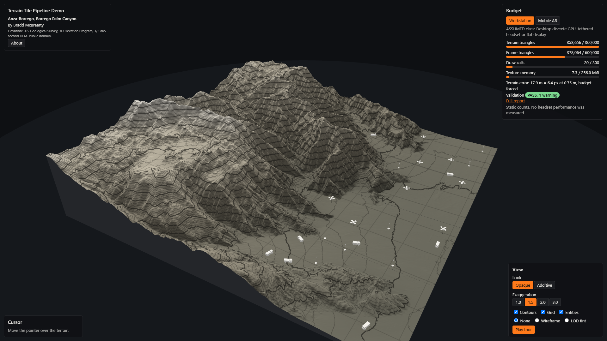

# Terrain Tile Pipeline Demo

[](https://github.com/mcbradd/terrain-tile-demo/actions/workflows/ci.yml)

One command takes public USGS elevation data to a validated, real-time terrain tile, built against two hardware budget profiles. A Blender toolchain validates entity assets while they are authored and again after export.

[](https://mcbradd.github.io/terrain-tile-demo/)

**Links:** [live viewer](https://mcbradd.github.io/terrain-tile-demo/) · [walkthrough video](https://mcbradd.github.io/terrain-tile-demo/video/walkthrough.mp4) · [validation report](https://mcbradd.github.io/terrain-tile-demo/report/index.html)

The viewer needs WebGL2 on a current desktop browser (tested in Chrome, Edge, Firefox and WebKit; see `docs/VERIFICATION.md`). The video is a silent, captioned screen capture.

## Reproduce

```text
uv sync --no-build
npm ci
uv run tilepipe all --no-blender
```

The same with the Blender steps: `uv run tilepipe all`. Blender 5.2.0 must be installed (see `uv run tilepipe preflight`). Run every command from the repository root. CI runs the core steps without Blender, and `node tools/capture/capture.mjs` retakes the hero images, the fallback picture and `bench.json` from `site/`.

Two areas are defined in `aois.toml`: Anza-Borrego (UTM zone 11N, the default) and Mount St. Helens (UTM zone 10N). Build the second with `uv run tilepipe all --aoi st_helens_01 --no-blender`. Both source crops are committed, so neither build uses the network. The viewer's title panel switches between built areas.

## What it shows

- **One-command pipeline.** Raw DEM to runtime assets, deterministic and offline after the first fetch.
- **Budgets in config.** Two hardware profiles. LOD selection, draw batching, validation, and the viewer all follow from one file per profile.
- **Measured LOD error.** Geometric error per chunk and level, in meters and in on-screen pixels, with the trade against the triangle budget reported.
- **Two-gate asset validation.** Rules run inside Blender while an artist works, then again on the exported glTF with no DCC in the loop. Every rule has a test asset built to break it.
- **Engine-agnostic contract.** glTF plus a JSON manifest, and a standalone GLSL ES 3.00 terrain shader that ports line for line.
- **Debug views.** An overdraw heat view with mean overdraw measured per profile in the report, and an illustrative slope-class overlay split at 15 and 30 degrees.

## Repository layout

```text
src/tilepipe/   core pipeline and validator (Python, no DCC dependency)
blender/        Blender extension and headless scripts
viewer/         real-time WebGL2 viewer
profiles/       hardware budget profiles
look/           terrain look presets
assets/         hand-modeled entity sources and their exports
data/source/    committed crop of the USGS source and its provenance
docs/           standards, decisions, open questions, provenance
tests/          unit and property tests
```

## Honest limits

- No headset performance was measured. Budgets are checked as static counts.
- Both hardware profiles are assumptions derived from public developer guidance, and are labeled as such in config.
- This is a sketch of method, not a proposal for any team's architecture.
- The site hosts one validation report, for the area validated last.
- Identical output is claimed on one machine only. The build is deterministic there, and no other machine was tested.
- Known limitations are listed in `docs/DECISIONS.md`: contours kink under magnification, normals are 8-bit, baked occlusion ignores exaggeration, and neighboring chunks at different LODs can show thin seams.

## Credits and licenses

- Code: [MIT](LICENSE). The `blender/` directory: [GPL-3.0-or-later](blender/LICENSE), as Blender add-ons require.
- Data and models: see [DATA_LICENSE.md](DATA_LICENSE.md).
- Elevation: U.S. Geological Survey, 3D Elevation Program, 1/3 arc-second DEM. Public domain.

Who made what is in [PROVENANCE.md](docs/PROVENANCE.md).

Built by Bradd McBrearty, directing AI coding agents from a written spec. Look development is hand-tuned. The three entities are placeholder tokens generated by script: the asset gates are the point, not the models.
